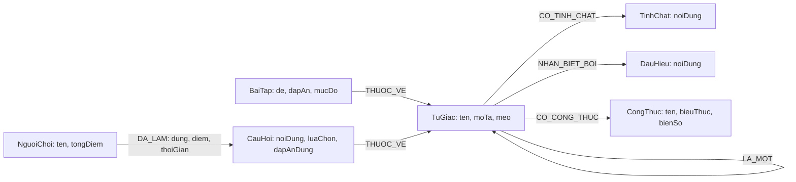

# Đặc tả phần mềm: Ứng dụng hỗ trợ học Toán hình học phẳng – Tứ giác

## 1. Giới thiệu và mục tiêu

Ứng dụng hỗ trợ học sinh lớp 8 ôn tập các loại tứ giác, tính chất, dấu hiệu nhận biết và công thức chu vi – diện tích. Học sinh có thể tra cứu kiến thức, xem quan hệ phân cấp giữa các hình, luyện bài có đáp án và làm quiz trắc nghiệm. Giáo viên có thể dùng nội dung mẫu để hướng dẫn ôn tập và quản trị bài tập, tính chất trong phạm vi ứng dụng.

Mục tiêu của bài tập NoSQL là minh họa cách biểu diễn tri thức hình học bằng đồ thị Neo4j. Mô hình tập trung vào các liên kết tự nhiên như “là một”, “có tính chất”, “nhận biết bởi” và “thuộc về”. Đây là sản phẩm học tập quy mô nhỏ; không xử lý tài khoản đăng nhập, tiền thưởng hoặc dữ liệu cá nhân ngoài tên hiển thị trên bảng điểm.

## 2. Người dùng

- **Học sinh lớp 8:** tra cứu nội dung, tự luyện bài, làm quiz và xem thứ hạng.
- **Giáo viên:** tham khảo kiến thức, theo dõi kết quả tổng hợp và thêm/sửa/xóa nội dung bài tập, tính chất phục vụ lớp học.

## 3. Yêu cầu chức năng

| ID | Chức năng | Mô tả / kết quả mong đợi |
|---|---|---|
| FR-01 | Xem danh sách và chi tiết | Liệt kê tám loại tứ giác; trang chi tiết hiển thị mô tả, mẹo ghi nhớ, tính chất, dấu hiệu và công thức. |
| FR-02 | Xem sơ đồ phân cấp | Thể hiện các quan hệ `LA_MOT` giữa hình con và hình cha, gồm các nhánh đã định nghĩa trong dữ liệu mẫu. |
| FR-03 | Tìm kiếm | Tìm theo từ khóa trong tên/mô tả hình, tính chất và dấu hiệu nhận biết. |
| FR-04 | Máy tính chu vi – diện tích | Hỗ trợ người học áp dụng công thức phù hợp và nhập các đại lượng cần thiết để tính kết quả. |
| FR-05 | Luyện tập chấm bài | Lọc bài theo hình và mức độ; nhận đáp án ngắn hoặc số, so sánh và thông báo kết quả. |
| FR-06 | Quiz tính điểm | Lấy câu trắc nghiệm ngẫu nhiên, kiểm tra lựa chọn và cộng 10 điểm cho câu trả lời đúng. |
| FR-07 | Bảng xếp hạng | Hiển thị người chơi theo tổng điểm giảm dần. Tên người chơi là định danh duy nhất trong dữ liệu. |
| FR-08 | Quản trị bài tập/tính chất (CRUD) | Thêm, xem, sửa và xóa bài tập; thêm, xem, sửa và xóa tính chất gắn với một hình. |

## 4. Yêu cầu phi chức năng

- Chạy với Python 3.10 trở lên, Neo4j và các thư viện khai báo trong `requirements.txt`.
- Kết nối lấy từ biến môi trường `NEO4J_URI`, `NEO4J_USER`, `NEO4J_PASSWORD`; không lưu thông tin xác thực trong mã nguồn.
- Các truy vấn ứng dụng dùng tham số, tránh ghép dữ liệu nhập vào chuỗi Cypher.
- Nội dung kiến thức ngắn gọn, tiếng Việt, phù hợp Toán 8; giao diện cần phản hồi lỗi kết nối dễ hiểu.

## 5. Mô hình dữ liệu đồ thị



Các ràng buộc duy nhất: `TuGiac.ten` và `NguoiChoi.ten`. Với quan hệ phân cấp, ví dụ `(:TuGiac {ten:'Hình vuông'})-[:LA_MOT]->(:TuGiac {ten:'Hình chữ nhật'})`.

## 6. Truy vấn Cypher tiêu biểu

**Liệt kê các loại hình:**

```cypher
MATCH (t:TuGiac)
RETURN t.ten AS ten, t.moTa AS moTa
ORDER BY ten
```

**Lấy tính chất và dấu hiệu nhận biết của một hình (tham số `$ten`):**

```cypher
MATCH (t:TuGiac {ten:$ten})
OPTIONAL MATCH (t)-[:CO_TINH_CHAT]->(p:TinhChat)
WITH t, collect(DISTINCT p.noiDung) AS tinhChat
OPTIONAL MATCH (t)-[:NHAN_BIET_BOI]->(d:DauHieu)
RETURN t.ten AS ten, tinhChat, collect(DISTINCT d.noiDung) AS dauHieu
```

**Đi qua chuỗi quan hệ `LA_MOT` để tìm các hình tổ tiên:**

```cypher
MATCH path=(con:TuGiac {ten:$ten})-[:LA_MOT*1..]->(cha:TuGiac)
RETURN [n IN nodes(path) | n.ten] AS duongDi
```

**Bảng xếp hạng:**

```cypher
MATCH (n:NguoiChoi)
RETURN n.ten AS ten, n.tongDiem AS tongDiem
ORDER BY tongDiem DESC, ten
LIMIT $gioi_han
```

## 7. Vì sao chọn Neo4j thay cho CSDL quan hệ?

- Quan hệ phân cấp nhiều nhánh thể hiện trực tiếp bằng cạnh `LA_MOT`, dễ truy vấn nhiều bước.
- Tính chất, dấu hiệu, bài tập và công thức liên kết với từng hình tự nhiên, không cần nhiều phép nối bảng.
- Mô hình trực quan, phù hợp minh họa kiến thức có quan hệ và mở rộng dữ liệu theo chủ đề.
- Cypher diễn đạt việc duyệt đồ thị ngắn gọn, thuận lợi cho bài tập thực hành NoSQL.
